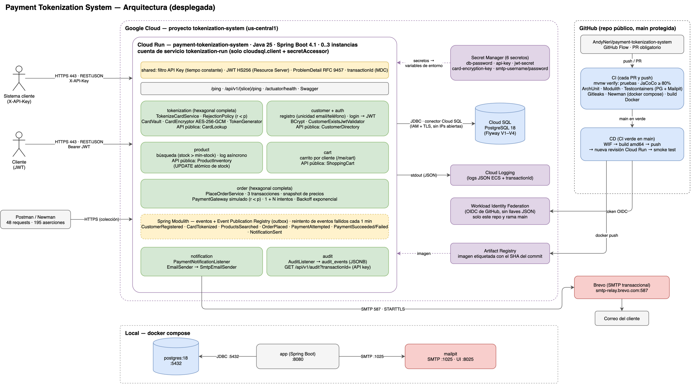

# Payment Tokenization System

Reto técnico de backend para Farmatodo: tokenización de tarjetas de crédito, gestión de clientes, búsqueda de productos, carrito, pedidos con pagos simulados (con reintentos), notificaciones por correo y auditoría centralizada.

**Stack:** Java 25 · Spring Boot 4.1 · PostgreSQL 18 · Flyway · Spring Modulith · Docker Compose · GitHub Actions · Google Cloud (Cloud Run, Cloud SQL, Secret Manager, Artifact Registry)

## API en línea
| | |
|---|---|
| **URL base** | https://payment-tokenization-system-871744551746.us-central1.run.app |
| Swagger UI | https://payment-tokenization-system-871744551746.us-central1.run.app/swagger-ui.html |
| Health | https://payment-tokenization-system-871744551746.us-central1.run.app/actuator/health |
| Ping | https://payment-tokenization-system-871744551746.us-central1.run.app/ping → `pong` |

La **API key** de producción (necesaria para `POST /api/v1/tokens` y `GET /api/v1/audit`) no está en el repositorio: se comparte por correo junto con la entrega. Todo lo demás se puede probar registrando un cliente y haciendo login.

**Probar el flujo completo:** importa la colección `postman/` con el entorno `gcp`, pon la `apiKey` y ejecuta el **Runner**. Ver [Colección Postman](#colección-postman).

## Resumen

| Indicador | Valor |
|---|---|
| Pruebas | 227 (unitarias, integración con PostgreSQL y Mailpit reales, arquitectura) |
| Cobertura de líneas | 99% (el build falla por debajo de 80%) |
| Pruebas de API | 48 requests · 195 aserciones (CI y contra GCP) |
| Despliegue | automático en cada merge a `main` (CI verde → Cloud Run) |

### Requisitos del reto → dónde están
| Requisito | Implementación |
|---|---|
| Tokenización con API key y probabilidad de rechazo configurable | `POST /api/v1/tokens` · AES-256-GCM, el CVV nunca se guarda · `TOKENIZATION_REJECTION_PROBABILITY` |
| `/ping` en todas las APIs | `/ping` y `/api/v1/{tokens,customers,auth,products,cart,orders,audit}/ping` |
| Registro de clientes con datos válidos y únicos | `POST /api/v1/customers` · email y teléfono únicos (también bajo concurrencia) |
| Búsqueda de productos + log asíncrono + stock mínimo | `GET /api/v1/products?q=` · `search_logs` por evento asíncrono · `PRODUCT_MIN_STOCK` |
| Carrito | `/api/v1/me/cart` |
| Pedido + pago con probabilidad y N reintentos | `POST /api/v1/orders` · `PAYMENT_REJECTION_PROBABILITY`, `PAYMENT_MAX_RETRIES`, backoff exponencial |
| Correo de éxito o fallo del pago | módulo `notification` (SMTP: Mailpit en local, Brevo en GCP) con reintento automático |
| Logs centralizados en BD con UUID por transacción | módulo `audit` · `GET /api/v1/audit?transactionId=` · header `X-Transaction-Id` |
| Docker + Compose | `Dockerfile` (multi-stage, usuario no root) · `docker-compose.yml` |
| Seguridad, configuración externa, robustez | API key + JWT, secretos solo por variables de entorno / Secret Manager, errores RFC 9457 |
| ≥ 80% cobertura, Postman, CI, pruebas continuas, CD | JaCoCo · `postman/` · `.github/workflows/ci.yml` y `cd.yml` |
| Despliegue en GCP documentado desde cero | [docs/deploy-gcp.md](docs/deploy-gcp.md) |

La tabla detallada (con secciones y ADRs) está en [docs/architecture.md § 12](docs/architecture.md).

## Documentación

| Documento | Contenido |
|---|---|
| [Arquitectura](docs/architecture.md) | Slices, puertos y adaptadores, seguridad, configuración, concurrencia, despliegue, supuestos, trazabilidad de requisitos |
| [Decisiones (ADR)](docs/decisions.md) | Por qué hexagonal, Java 25, AES-256-GCM, API Key + JWT, checkout síncrono, Modulith, Cloud Run |
| [Modelo de datos](docs/data-model.md) | ERD y tablas |
| [API](docs/api.md) | Endpoints, autenticación, ejemplos y catálogo de errores |
| [Despliegue en GCP](docs/deploy-gcp.md) | Paso a paso desde cero: Cloud SQL, Secret Manager, Cloud Run, CD con Workload Identity Federation |
| [Flujos](docs/sequences.md) | Diagramas de secuencia: tokenización, login, búsqueda, checkout |
| [Diagrama de arquitectura](docs/diagrams/architecture.drawio) | Componentes, protocolos, GCP y CI/CD (PNG arriba; el `.drawio` se abre en [diagrams.net](https://app.diagrams.net)) |
| [Uso de IA](docs/ai-usage.md) | Herramientas, configuración y prompts usados |

## Descripción del sistema
**Monolito modular** con **arquitectura hexagonal** y **vertical slicing por feature**: un módulo por funcionalidad y, dentro de cada uno, `domain` (reglas del negocio en Java puro) → `application` (casos de uso) → `infrastructure` (web, base de datos, cifrado, SMTP). Los módulos se comunican solo por su API pública o por eventos; ArchUnit y Spring Modulith lo verifican en cada build.



```
src/main/java/com/farmatodo/challenge/
├── shared/         seguridad (API key, JWT), errores RFC 9457, transactionId, configuración
├── auth/           login → JWT
├── customer/       registro y perfil
├── tokenization/   tokenización de tarjetas (AES-256-GCM)
├── product/        catálogo, búsqueda, stock
├── cart/           carrito
├── order/          checkout y pago simulado con reintentos
├── notification/   correos de pago
└── audit/          bitácora por transactionId
```

**Decisiones principales** (detalle y alternativas en [docs/decisions.md](docs/decisions.md)):
- **Datos de tarjeta:** AES-256-GCM con IV aleatorio, el token como dato asociado y `key_id` para rotar la llave. El CVV se valida y se descarta.
- **Stock:** `UPDATE ... WHERE stock >= :cantidad` atómico; sin sobreventa bajo concurrencia.
- **Checkout:** síncrono, en 3 transacciones cortas (no se retiene una conexión mientras se cobra). Correos y auditoría son asíncronos y confiables (patrón *outbox* con Spring Modulith).
- **Probabilidades:** se rechaza si `r < p`, así `p = 0` nunca rechaza y `p = 1` siempre (ADR-007).

## Ejecutar en local

**Requisitos:** Docker (con Docker Compose). Para compilar o probar fuera de Docker: JDK 25.

```bash
cp .env.example .env
# Completa los secretos en .env (los comandos para generarlos están en el mismo archivo):
#   API_KEY=$(openssl rand -hex 32)   JWT_SECRET=$(openssl rand -base64 32)   CARD_ENCRYPTION_KEY=$(openssl rand -base64 32)

docker compose up --build
curl http://localhost:8080/ping   # → pong
```

| Servicio | URL |
|---|---|
| API | http://localhost:8080 |
| Swagger UI | http://localhost:8080/swagger-ui.html |
| Health | http://localhost:8080/actuator/health |
| Mailpit (correos enviados) | http://localhost:8025 |
| PostgreSQL | `localhost:5432` (credenciales en `.env`) |

La app no arranca si falta un secreto o si es débil (validación *fail-fast*).

**Desde el IDE, sin `.env`:** ejecuta `TestPaymentTokenizationSystemApplication` (en `src/test`). Levanta un PostgreSQL temporal con Testcontainers y usa el perfil `test`.

## Pruebas
```bash
export JAVA_HOME=$(/usr/libexec/java_home -v 25)   # macOS: si tu JDK por defecto no es el 25
./mvnw verify
```
`verify` ejecuta:
- Pruebas unitarias.
- Pruebas de integración contra **PostgreSQL real** (Testcontainers; requiere Docker).
- Reglas de arquitectura (**ArchUnit**: el dominio no depende de frameworks; **Spring Modulith**: límites entre módulos).
- El umbral de cobertura **JaCoCo ≥ 80%**: el build falla si no se cumple.

| Reporte | Ruta |
|---|---|
| Cobertura | `target/site/jacoco/index.html` |
| Diagramas de módulos (PlantUML) | `target/spring-modulith-docs/` |

## Colección Postman

| Archivo | Contenido |
|---|---|
| `postman/payment-tokenization.postman_collection.json` | 48 requests en 8 carpetas (Health, Customers, Auth, Tokenization, Products, Cart, Orders, Audit), con 195 aserciones automáticas |
| `postman/local.postman_environment.json` | `baseUrl = http://localhost:8080` |
| `postman/gcp.postman_environment.json` | `baseUrl = https://payment-tokenization-system-871744551746.us-central1.run.app` |

**Uso manual (Postman):** importa la colección y un entorno, completa la variable `apiKey` (es de tipo *secret*) y ejecuta la colección completa con el **Runner**, en orden. Los requests encadenan datos: el registro guarda `customerId`, el login guarda `accessToken` y la tokenización guarda `cardToken`.

**Uso automatizado (Newman):**
```bash
# local
npx newman run postman/payment-tokenization.postman_collection.json \
  -e postman/local.postman_environment.json \
  --env-var "apiKey=$(grep '^API_KEY=' .env | cut -d= -f2)"

# GCP
npx newman run postman/payment-tokenization.postman_collection.json \
  -e postman/gcp.postman_environment.json --env-var "apiKey=<api key de la entrega>"
```

Qué validan las pruebas:
- Status y cuerpo de cada respuesta.
- Formato RFC 9457 en los errores (`code`, `transactionId`).
- Header `X-Transaction-Id` y tiempo de respuesta en todos los requests.
- Que el PAN y el CVV nunca aparezcan en las respuestas ni en la auditoría.
- Que la auditoría de un checkout tenga toda la historia (pedido, cada intento de pago, resultado y correo) bajo el mismo `transactionId`.

La tokenización tiene un rechazo aleatorio configurable (422). Esos requests **reintentan solos hasta 5 veces**, como lo haría un cliente real, así que la colección es estable con cualquier probabilidad razonable.

En el **CI**, el job `API tests` levanta el stack con `docker compose` (con secretos aleatorios de un solo uso) y ejecuta la colección con Newman en cada push y PR.

## Despliegue en GCP desde cero
La guía completa, con todos los comandos, está en **[docs/deploy-gcp.md](docs/deploy-gcp.md)**. En resumen:

| Pieza | Servicio |
|---|---|
| App (contenedor) | **Cloud Run** (us-central1), cuenta de servicio propia con permisos mínimos |
| Base de datos | **Cloud SQL** PostgreSQL 18, conexión por el *Cloud SQL Java Connector* (IAM + TLS, sin IPs abiertas) |
| Secretos | **Secret Manager** → variables de entorno (`API_KEY`, `JWT_SECRET`, `CARD_ENCRYPTION_KEY`, `DB_PASSWORD`, `SMTP_*`) |
| Imágenes | **Artifact Registry** |
| Correo | SMTP transaccional (**Brevo**, 587 STARTTLS) |
| CD | **GitHub Actions** con **Workload Identity Federation** (sin llaves JSON) |

Pasos: (1) configuración de gcloud aislada, (2) activar APIs, (3) Cloud SQL + usuario, (4) secretos, (5) Artifact Registry + cuenta de servicio, (6) primera imagen, (7) `gcloud run deploy`, (8) WIF + workflow de CD.

## CI/CD
**CI** (`.github/workflows/ci.yml`), en cada push y pull request:
1. **Build y pruebas:** `./mvnw verify` (pruebas, reglas de arquitectura y umbral de cobertura). Publica el resumen de cobertura y los reportes como artefactos.
2. **Escaneo de secretos:** Gitleaks sobre todo el historial.
3. **Pruebas de API:** el stack completo con Docker Compose + la colección Postman con Newman (reporte JUnit como artefacto).
4. **Build de la imagen Docker.**

**CD** (`.github/workflows/cd.yml`): cuando el CI termina en verde en `main`, construye la imagen, la sube a Artifact Registry, despliega una revisión nueva en Cloud Run y hace un *smoke test* contra la URL real (`/ping`, `/actuator/health` y la carpeta *Health* de Postman). Se autentica con Workload Identity Federation.
