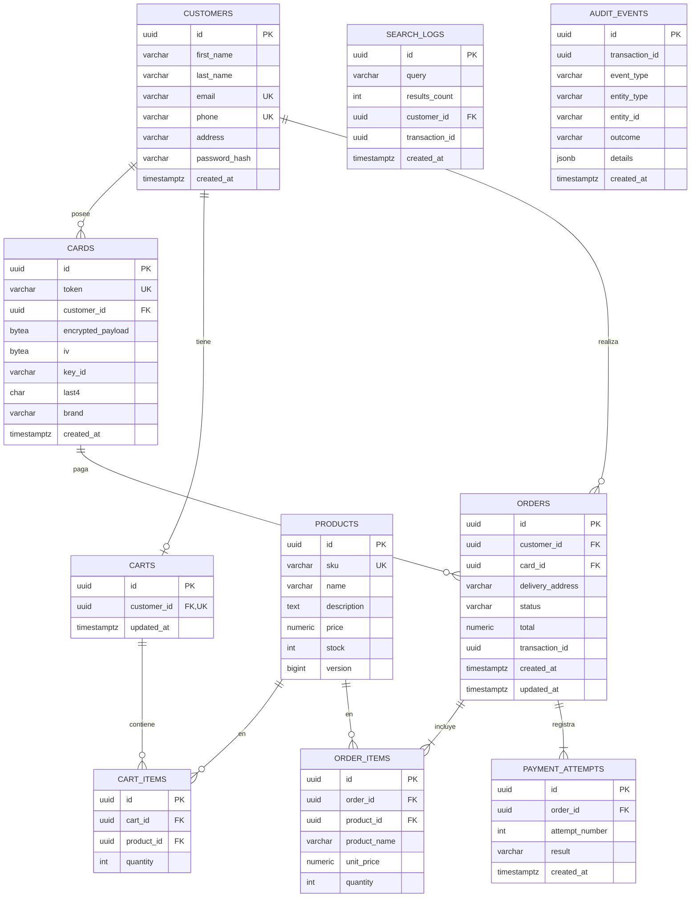

# Modelo de datos

PostgreSQL 18, con el esquema gestionado por **Flyway** (`src/main/resources/db/migration`).
Los IDs son **UUID v7** (generados por Hibernate `@UuidGenerator(style = VERSION_7)`): no exponen secuencias y, como están ordenados en el tiempo, mantienen buena localidad en los índices B-tree.

## ERD

> `audit_events` no tiene FKs a propósito: es un log *append-only* que debe sobrevivir aunque cambien o se borren las entidades.
> `event_publication` (Spring Modulith) no aparece en el diagrama: la crea Flyway según el esquema oficial de Modulith.

## Tablas

### `customers` — slice `customer`
| Columna | Tipo | Restricciones |
|---|---|---|
| id | uuid | PK |
| first_name, last_name | varchar(100) | NOT NULL |
| email | varchar(254) | NOT NULL, **UNIQUE** (se guarda en minúsculas) |
| phone | varchar(20) | NOT NULL, **UNIQUE** (normalizado a E.164) |
| address | varchar(255) | NOT NULL |
| password_hash | varchar(100) | NOT NULL (BCrypt) |
| created_at | timestamptz | NOT NULL DEFAULT now() |

### `cards` — slice `tokenization`
| Columna | Tipo | Restricciones / notas |
|---|---|---|
| id | uuid | PK |
| token | varchar(40) | NOT NULL, **UNIQUE** (`tok_…`) |
| customer_id | uuid | FK → customers, índice |
| encrypted_payload | bytea | AES-256-GCM(`{pan, expMonth, expYear, holderName}`) + tag |
| iv | bytea | 12 bytes, único por registro |
| key_id | varchar(20) | versión de la llave que cifró la fila (para rotarla) |
| last4 | char(4) | en claro, para mostrar |
| brand | varchar(20) | VISA, MASTERCARD, AMEX… |
| created_at | timestamptz | |

**No hay columna para el CVV** (ADR-005).

### `products` — slice `product`
| Columna | Tipo | Restricciones |
|---|---|---|
| id | uuid | PK |
| sku | varchar(40) | UNIQUE |
| name | varchar(150) | NOT NULL, índice GIN `pg_trgm` para `ILIKE '%q%'` |
| description | text | |
| price | numeric(12,2) | CHECK > 0 |
| stock | int | CHECK ≥ 0 |
| version | bigint | se incrementa en cada cambio de stock (`@Version`); el descuento usa un `UPDATE` atómico condicional (ADR-011) |

Índice parcial opcional: `(stock)`, para el filtro `stock > :minStock`.

### `search_logs` — slice `product` (escritura asíncrona)
`id`, `query`, `results_count`, `customer_id` (nullable, **sin FK** desde V4), `transaction_id`, `created_at`. Índices en `created_at` y `customer_id`.

> Es un log *append-only*, como `audit_events`: escribir un log nunca debe fallar porque la entidad referenciada cambió o desapareció. La FK original se eliminó en `V4__search_logs_without_customer_fk.sql`.

### `carts` / `cart_items` — slice `cart`
- `carts.customer_id` es **UNIQUE**: un carrito activo por cliente.
- `cart_items`: UNIQUE(`cart_id`, `product_id`); al volver a agregar un producto, se suma a la cantidad existente. CHECK `quantity > 0`.

### `orders` / `order_items` / `payment_attempts` — slice `order`
- `orders.status`: `PENDING_PAYMENT` → `PAID` | `PAYMENT_FAILED`.
- `order_items` guarda una **copia** de `product_name` y `unit_price` al momento de la compra (el precio del catálogo puede cambiar después).
- `payment_attempts`: un registro por intento (`attempt_number` 1..N+1, `result` `APPROVED` | `REJECTED`). UNIQUE(`order_id`, `attempt_number`).

### `audit_events` — slice `audit`
| Columna | Ejemplo |
|---|---|
| transaction_id | UUID del request (header `X-Transaction-Id`) |
| event_type | `CARD_TOKENIZED`, `TOKENIZATION_REJECTED`, `CUSTOMER_REGISTERED`, `PRODUCTS_SEARCHED`, `ORDER_CREATED`, `PAYMENT_ATTEMPT`, `PAYMENT_SUCCEEDED`, `PAYMENT_FAILED`, `EMAIL_SENT`, `EMAIL_FAILED` |
| entity_type / entity_id | `ORDER` / `0193…` |
| outcome | `SUCCESS` / `FAILURE` |
| details | jsonb sin datos sensibles (p. ej. `{"attempt":2,"reason":"RANDOM_REJECTION"}`) |

Índices: `transaction_id`, (`entity_type`, `entity_id`), `created_at`.

## Migraciones previstas
| Versión | Contenido |
|---|---|
| `V1__init_schema.sql` | Todas las tablas, constraints e índices + extensión `pg_trgm` |
| `V2__event_publication.sql` | Tabla del Event Publication Registry de Spring Modulith |
| `V3__seed_products.sql` | ~40 productos de farmacia (algunos con stock 0–3 para demostrar el filtro de stock mínimo) |
| `V4__search_logs_without_customer_fk.sql` | Quita la FK de `search_logs.customer_id` (log append-only) |
