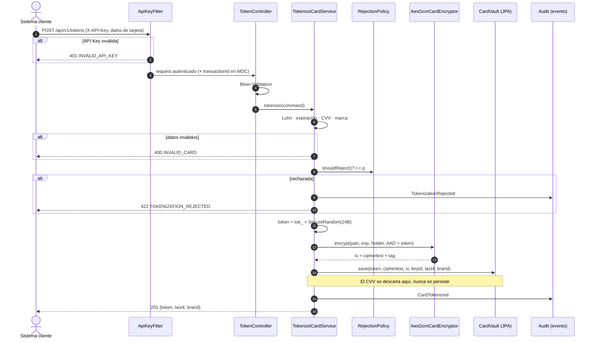
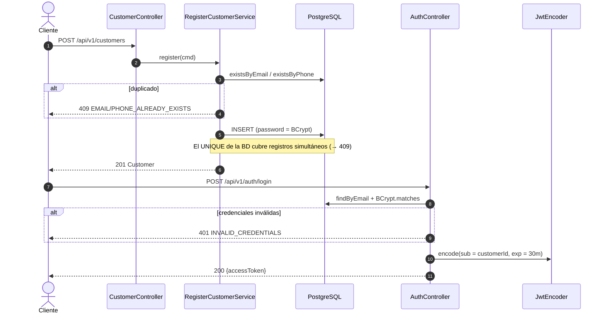
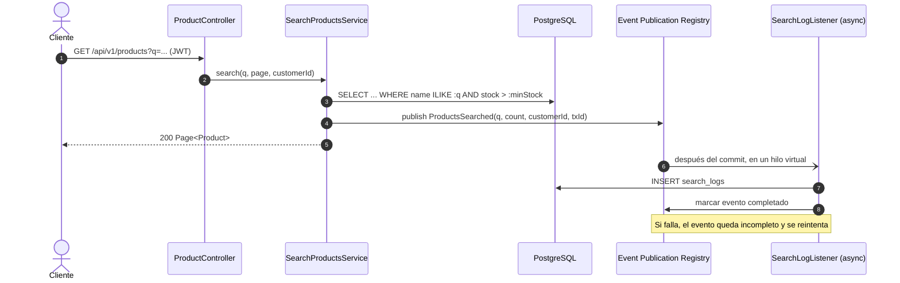
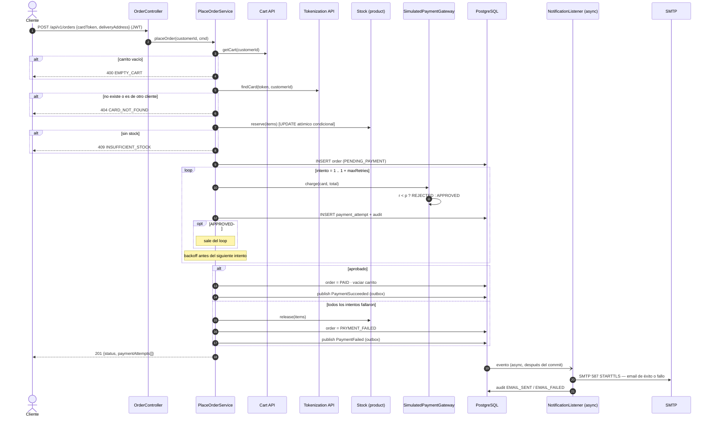

# Flujos principales

## 1. Tokenización de tarjeta

## 2. Registro y login

## 3. Búsqueda de productos con log asíncrono

## 4. Checkout: pago con reintentos y notificación

### Transacciones del checkout
- **T1:** reservar stock + crear la orden `PENDING_PAYMENT`. El commit ocurre antes de cobrar, así la orden existe aunque la app se caiga a mitad del pago.
- **T2 (por intento):** guardar `payment_attempt`. Cada intento queda registrado aunque los siguientes fallen.
- **T3:** estado final + vaciar el carrito o liberar el stock + publicar el evento (que se guarda en `event_publication` en la misma transacción, patrón outbox).
- La reserva de stock es un `UPDATE ... WHERE stock >= :q` por producto, dentro de T1: si un producto no alcanza, toda la reserva hace rollback y se responde `409 INSUFFICIENT_STOCK`.
